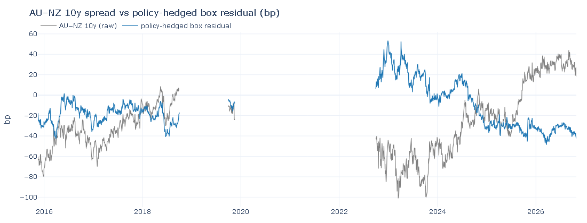
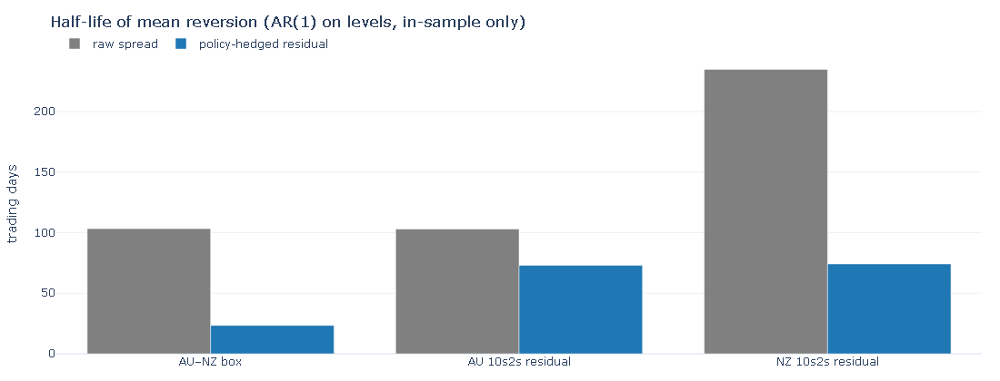
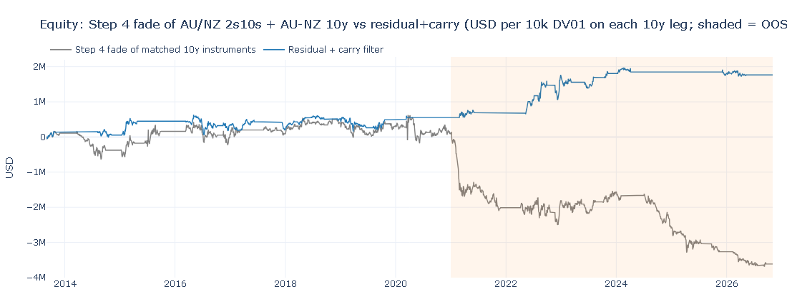
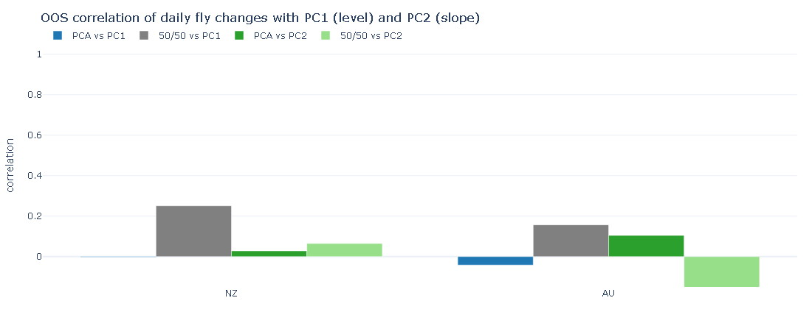

# AUD/NZD rates relative value

**Question.** Do Australian and New Zealand government and swap curves contain
fadable relative-value stretches, or do they just trend with the policy cycle?

**Method.** Public RBA F2 and RBNZ B2 end-of-day yields; walk-forward 250-day
z-scores of 2s10s, flies, AU–NZ spreads and NZ swap spreads; fade `|z| > 2` with
next-day execution, DV01-neutral books and stated costs. After that rule lost
money, a second hypothesis hedged the 2y/policy factor out of the 10y spread
and faded the residual only when 3-month carry agreed.

**Finding.** Fading the raw spreads failed out of sample (Sharpe **−1.03**). A
policy-hedged residual **with** a carry filter was profitable on a small sample
(OOS Sharpe **+0.59**, 14 trades). The same residual **without** the filter, and
a carry-only book that never waits for a 2-sd stretch, both lost money. The
edge is the scarce combination of a stretch *and* carry — and that hypothesis
was chosen after seeing the first failure, so 2021– is not a pristine hold-out.

---

## Key results

In-sample (IS) 2 Sep 2013 – 31 Dec 2020; out-of-sample (OOS) 1 Jan 2021 – latest.
PnL is USD per $10k DV01 on the 10y (or long) leg. Parameters were fixed in
advance; nothing below is tuned on OOS.

| Book | Sample | Trades | Hit % | Avg bp | Sharpe |
|---|---|---|---|---|---|
| Step 4 fade of raw z-scores (14 instruments) | IS | 238 | 42 | −2.0 | **−0.29** |
| Step 4 fade of raw z-scores (14 instruments) | OOS | 227 | 27 | −4.3 | **−1.03** |
| Residual + carry filter | IS | 22 | 55 | +2.5 | **+0.25** |
| Residual + carry filter | OOS | 14 | 86 | +8.7 | **+0.59** |
| Residual, no carry filter | IS | 47 | 51 | −2.7 | **−0.23** |
| Residual, no carry filter | OOS | 39 | 44 | −2.2 | **−0.36** |
| Carry-only (unstretched residual) | IS | 162 | 27 | −2.3 | **−1.01** |
| Carry-only (unstretched residual) | OOS | 176 | 21 | −3.6 | **−1.18** |

Half-life of mean reversion (AR(1) on **levels**, IS only):

| Instrument | Raw spread | Policy-hedged residual |
|---|---|---|
| AU–NZ 10y vs box residual | 103d | **23d** |
| AU 2s10s | 103d | **73d** |
| NZ swap 2s10s | 235d | **74d** |

**Robustness.** Residual+carry is 27 longs / 9 shorts (AU 10s2s never shorted:
carry of a long residual is usually positive). Pooled 36 trades: mean
**+4.9 bp**, *t* = 1.96, *p* = 0.06; bootstrap 90% CI **[+0.8, +8.9] bp**
(excludes 0). Carry-only in the complementary `|z| < 2` region loses after
costs, so the stretch is doing work — but *n* = 36 is small and OOS is not
pristine.









PCA flies are close to PC1/PC2-neutral out of sample (NZ daily-change corr with
PC1 **−0.00** vs **+0.25** for a 50/50 fly; AU **−0.04** vs **+0.16**). Latest
weights: NZ sell 0.54 of 2y and 0.54 of 10y per 1 of 5y; AU sell 0.74 of 2y and
0.34 of 10y.

---

## Method

**Data.** RBA table F2 (interpolated AUD government yields, 2/3/5/10y) is
downloaded automatically. RBNZ table B2 (NZ government **benchmark** bonds and
swaps) is dropped by hand into `data/manual/` — RBNZ restricts automated
access. Yields are stored in **percent**, converted to bp only when instruments
are built. Interior gaps of at most two weekdays are forward-filled; filled
days never generate a signal.

**Rolls.** NZ 2/5/10y yields are specific bonds and jump when RBNZ switches
benchmark. Confirmed / unclear / pending roll-day changes are excluded from
PCA, residuals, backtest and PnL; new trades are blocked for 20 trading days
after a confirmed or unclear roll (pending rolls block until reviewed).
Back-adjusted `*_adj` series are diagnostic only and never traded.

**Instruments (bp).** NZ swap 2s5s / 2s10s / 2s5s10s; AU bond 2s5s / 2s10s /
2s5s10s; AU−NZ bond 2y / 5y / 10y; NZ swap minus NZ bond at 2y / 5y / 10y.
Plus a PCA 2s5s10s fly on each curve.

**Z-scores.** 60- and 250-trading-day windows ending today, real (not filled)
observations only, no look-ahead. Insufficient history if fewer than 80% of
the window is real or a gap exceeds 10 trading days.

**PCA.** Rolling 250-day PCA on yield *changes*. Fly weights solve
`w · PC1 = 0` and `w · PC2 = 0` on 2y/5y/10y with 5y weight = 1. At date *t*
the fly history is rebuilt with *t*'s weights, then z-scored.

**Backtest (Step 4).** Signal at close *t*, trade at close *t+1*. Fade:
short when `z_250 > +2`, long when `z_250 < −2`. Exit `|z| < 0.5`, stop
`|z| > 3.5`, max hold 60 trading days. One position per instrument. Notionals
`N_i D_i = k w_i` with the long side = $10k DV01 (par modified duration at a
stated 4%). One-way costs 0.5 bp per NZ swap leg, 1 bp per government-bond
leg, charged at entry and exit. No new trade on filled, roll, post-roll or
pending-roll days.

**Residual box (Hypothesis 3).**
`residual = y_10y − β_t × y_2y` (and the AU−NZ box analogue). `β_t` is a
250-day OLS of daily *changes*, fitted only up to *t*; filled and roll days
dropped. The z-score window is rebuilt with that day's β. Hedge DV01 =
`β × $10k` of the 10y combo. Extra filter: fade only if 3-month carry +
rolldown of that direction is ≥ 0. Carry/rolldown is interpolated off the
current curve (funding at the shortest available tenor; no extrapolation past
the end-points; par duration at the current yield; no convexity).

---

## What failed and why

Fading raw 250-day z-scores **lost money**, more so out of sample than in
sample. 2021–23 hiking and 2024–26 easing each ran as a one-way
flatten-then-steepener; a 250-day window treats a persistent policy-cycle
trend as a stretch to fade. Simple 2s5s10s flies stop out on half or more of
OOS trades, and round-trip costs (1 bp swap, 2 bp bonds) are large next to a
move from 2 sd back to 0.5 sd. Every cell of an entry/exit sensitivity table
was also OOS-negative, so this is not an artefact of the 2.0 / 0.5
thresholds.

Hedging out the 2y factor shortens the memory of the spread (especially the
AU–NZ box: 103d → 23d). That is necessary but not sufficient: the residual
without a carry filter still loses OOS (Sharpe −0.36). Adding the carry
filter cuts the book to 14 OOS trades and flips the sign. Sitting in carry
whenever the residual is *not* stretched loses after costs (OOS Sharpe −1.18).

---

## Limitations

* Public end-of-day generic benchmarks, not individual bonds or a fitted curve.
* No AUD swaps (RBA F2 is government bonds only).
* DV01 is par modified duration at a stated 4%; carry/rolldown is a linear
  interpolation of the published tenors. No convexity, no repo specials, no
  AU vs NZ duration difference beyond tenor.
* Residual+carry is 36 trades. Hypothesis 3 was chosen from desk practice
  **after seeing Step 4**, so 2021– is not a pristine hold-out.
* No look-ahead in the statistics, but also no live execution, no bid/offer
  beyond the stated yield costs, and no capacity constraint.

---

## How a desk would extend this

* Trade **individual bonds** against a fitted curve (or against bond futures)
  instead of generic 2y/10y benchmarks — rolls become a known switch, not a
  hole in the series.
* Put the AU–NZ box in **futures** (YT / ZB-equivalent or local 3y/10y) and
  book the basis explicitly.
* Overlay a **supply calendar** (ACGS / NZGB syndication and tender dates)
  rather than treating every 2-sd residual as interchangeable.
* Replace the interpolated funding assumption with **repo / GC and specials**,
  and with actual 3m carry from the discount curve.

---

## How to run

Python **3.13**. Drop the latest RBNZ B2 file into `data/manual/`
(RBA F2 is fetched automatically).

```powershell
py -3.13 -m venv .venv
.\.venv\Scripts\activate
pip install -r requirements.txt
python run_all.py
pytest
```

`run_all.py` runs fetch → validate → rolls → instruments → PCA → scanner →
residuals → backtests → robustness charts. If validation finds an error, it
**stops and leaves previous outputs unchanged**. New NZ-bond roll candidates
are marked `pending` until you confirm or reject them:

```powershell
python -m src.rolls --confirm 2026-11-20 nz_gov_2y
python -m src.rolls --reject  2026-11-20 nz_gov_2y
```

Individual steps remain available as `python -m src.fetch`, `src.rolls`,
`src.spreads`, `src.pca`, `src.scanner`, `src.residual`, `src.backtest`,
`src.robustness`.

The **code** in this repository is MIT-licensed (see `LICENSE`). The yield
data remain copyright of the central banks (and, for some NZ series, of the
third parties named on the source table). See below.

---

## Data sources and attribution

No Bloomberg (or other vendor terminal) data is used anywhere in this project.

**Reserve Bank of Australia**, Statistical Table F2 — Capital Market Yields –
Government Bonds – Daily (series FCMYGBAG2D / 3D / 5D / 10D). Downloaded at
run time into `data/raw/` (gitignored); the merged yields live in
`data/processed/rates.csv`. RBA material is © Reserve Bank of Australia.
F2 is RBA financial data: reproduce only with attribution
(`Source: Reserve Bank of Australia`), without implying RBA endorsement, and
subject to the [RBA copyright notice](https://www.rba.gov.au/copyright/).

**Reserve Bank of New Zealand**, Statistical Table B2 — Wholesale interest
rates. The official workbooks currently in the repo are
`data/manual/hb2-daily-close.xlsx` (current) and
`data/manual/hb2-daily-close-1985-2017.xlsx` (history). RBNZ material is
© Reserve Bank of New Zealand and may be reproduced if the Bank is
acknowledged as source and copyright owner, the material is reproduced
accurately, and it is not used in a misleading way
([RBNZ terms of use](https://www.rbnz.govt.nz/copyright)). That permission
**does not extend to third-party material**. B2 itself names RBNZ, Reuters
and NZFMA as sources — swap rates in particular may be third-party
copyright. Check those terms before redistributing the workbooks.

This project is independent research. It is not affiliated with, or endorsed
by, the RBA, the RBNZ, Reuters or NZFMA.
