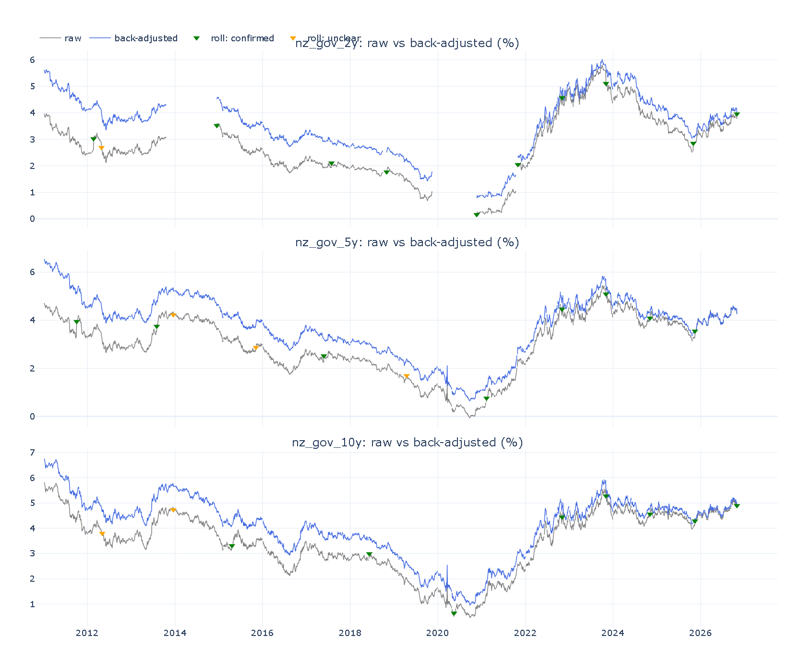
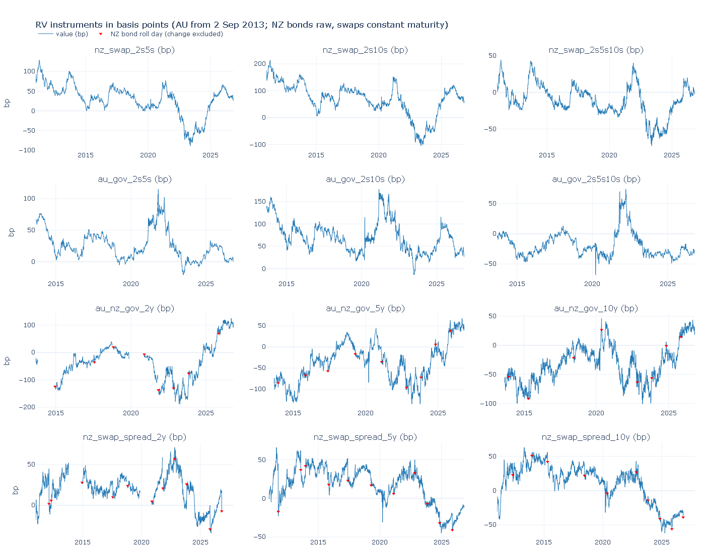
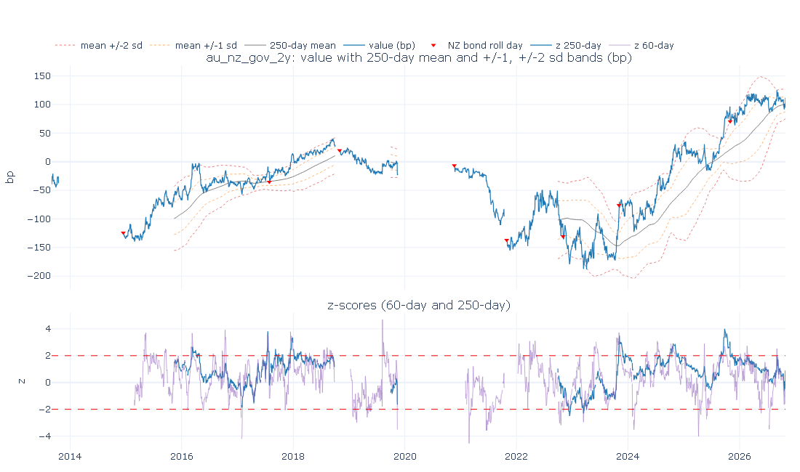

# Rates Relative Value (RV) Scanner — Australia & New Zealand

A research project that mirrors the workflow of a rates relative-value trading desk:
a daily scanner for unusually stretched spreads, a backtester, a paper-trading PnL
book and a public dashboard. *(Work in progress — built step by step; sections marked
"coming" are filled in as each step is completed.)*

**Python version:** the project targets **Python 3.13** (`.python-version`).

---

## What is relative value?

Instead of betting on whether interest rates go up or down (an *outright* view),
an RV trader bets on the **relationship between two or more rates** — for example
"the 10-year yield is unusually high compared with the 2-year and 5-year yields".
Positions are built so that a parallel move of the whole curve makes roughly zero
profit or loss; the trade only makes money if the relationship returns to normal.

*(Methodology for PCA, backtest and PnL: coming.)*

---

## Step 0 — Data (`src/fetch.py`, `src/validate.py`, `src/rolls.py`)

### Sources

| Clean name | Source | Series ID | What it is |
|---|---|---|---|
| `au_gov_2y`, `au_gov_3y`, `au_gov_5y`, `au_gov_10y` | RBA table F2 | FCMYGBAG2D / 3D / 5D / 10D | Australian Government nominal bond yields, "interpolated, N years maturity" (see below) |
| `nz_gov_2y`, `nz_gov_5y`, `nz_gov_10y` | RBNZ table B2 | INM.DG102 / DG105 / DG110.NZZCF | NZ government **benchmark** bond closing yields |
| `nz_swap_2y`, `nz_swap_5y`, `nz_swap_10y` | RBNZ table B2 | INM.DS02 / DS05 / DS10.NZZC | NZ swap rates (close) |

Australia has government bonds only (no swap data), so AUD instruments are built from bonds.
The full mapping, including the original series names, is saved to `data/processed/series_meta.csv`
and printed on every run.

### How the data is updated

* **RBA F2** is downloaded automatically with ordinary HTTP requests. The RBA publishes
  F2 **weekly** (Fridays, with daily yields up to two business days earlier), so
  Australian data usually lags New Zealand data by a few days.
* **RBNZ B2 is supplied manually** (see below), because RBNZ restricts automated access
  to its website and this project respects that.
* Each run re-reads the full source files and *upserts* into `data/processed/rates.csv`:
  new dates are added and missing values filled; values from the last 30 calendar days may
  be revised; **older history is never changed** (differences are logged as warnings).
* `rates.csv` stores values **in percent, exactly as published**, with gaps left empty.
  Small gaps (up to 2 days, e.g. public holidays in one country) are forward-filled only
  when the data is read, and never beyond a series' last published value.
* Every run validates the data: implausible values (an error — nothing is saved),
  moves larger than 25bp in a day, stale (unchanged) values, missing dates, and out-of-date
  sources. Results go to `data/processed/validation_report.csv`.

### Manual NZ data step

1. Go to the RBNZ [Wholesale interest rates (B2)](https://www.rbnz.govt.nz/statistics/series/exchange-and-interest-rates/wholesale-interest-rates) page.
2. Download **"Wholesale Interest Rates – B2 Daily close (2018-current)"** (`hb2-daily-close.xlsx`).
   The first time only, also download the **1985–2017** file for history.
3. Put the file(s) in `data/manual/` (any name containing `b2`, `.xlsx` or `.csv`), replacing the old current file.
4. Run `python -m src.fetch` (or push to GitHub — a push to `data/manual/` triggers the workflow).

All B2 files in `data/manual/` are read; where they overlap, the file with the latest
"Published Date" wins.

### NZ benchmark bond rolls

RBNZ's "2/5/10 year" government bond yields are specific benchmark bonds that RBNZ
switches to newer bonds about once a year, creating artificial jumps. NZ swap rates are
constant-maturity and don't roll, so they are the primary NZ curve (curves, flies, PCA).

Roll dates were reviewed by hand and are kept in `data/processed/roll_dates.csv`:

| status | include | effect |
|---|---|---|
| confirmed (26) | Y | history before the date is back-adjusted by the jump (`nz_gov_*_adj` in `rates_adjusted.csv`), and the roll-day change is excluded from PCA, backtest and PnL |
| unclear (6) | N | roll-day change excluded as a precaution; history **not** adjusted |
| pending | N | a new automatic candidate: change excluded from paper-book PnL, instruments shown as "pending roll review", no new paper trades until reviewed |
| rejected | N | ignored (a real market move) |

After a run flags a new candidate, review it and run
`python -m src.rolls --confirm YYYY-MM-DD nz_gov_2y` (or `--reject`).



**Caveat on back-adjusted levels.** Between switches a benchmark bond gets shorter and
"rolls down" the curve; each switch to a longer bond resets this, usually upwards. The
back-adjusted series removes the resets but keeps the roll-down, so earlier adjusted
levels drift away from what was traded (by 1.7 percentage points for the 2y by 2011).
Daily changes and rolling z-scores before a roll are not affected; long-history levels
and percentiles are.

### Australian yields: method and the 2013 file join

RBA describes each current F2 series as *"Yields on Australian government bonds,
interpolated, N years maturity"*, which is why no AU roll adjustment is applied. The
F2 notes describe the data only as *"the Reserve Bank of Australia (RBA)'s assessment
of closing bond yields on Australian Government Securities"*, and RBA's changes page
records that *"the calculation methodology for a number of interest rate series in
Tables F2 and F2.1 has also been changed"* (31 March 2023). On 29 December 2023 the 2, 3,
5 and 10 year series were *"replaced ... by series calculated from data representing the
Reserve Bank of Australia (RBA)'s assessment of closing bond yields"*. RBA does not publish
the interpolation method itself. The 1995–2013 history file describes its series only as
*"N years maturity"* (no "interpolated").

The history file ends 17 May 2013. The 10y continues seamlessly on 20 May 2013; the
2y, 3y and 5y resume only on 2 September 2013 after a 75-weekday gap, so a method
change there can't be separated from market moves (`python -m src.diagnostics`,
output in `outputs/diagnostics/rba_2013_join.csv`). Day-to-day AU moves unexplained by
NZ swaps are also about twice as frequent in the history file as in the current file.

The two methodology-change dates inside the current file (31 March 2023 and 29 December
2023) show no break: on each date the AU move not explained by NZ swaps was at most about 6bp,
in line with ordinary days (`python -m src.diagnostics --events 2023-03-31 2023-12-29`,
output in `outputs/diagnostics/rba_method_change_windows.csv`). If RBA recalculated the
whole history on the new method, no break would be visible anyway.

**Decisions for the analysis** (in `config.yaml` → `instruments`):
* AU instruments start on **2 September 2013** (current RBA file only).
* NZ swap spreads and AU–NZ bond spreads use **raw** NZ bond yields, so levels match what
  traded; the change on every confirmed, unclear or pending roll day is excluded.
  Back-adjusted yields in `rates_adjusted.csv` are **diagnostic only** — no instrument uses them.
* Bond-based instruments (NZ swap spreads, AU–NZ bond spreads) open no new trades for
  **20 trading days** after a confirmed or unclear roll in an NZ bond they use
  (`post_roll_block_days`), and none while a roll is pending review.
* New roll candidates (after 2 Nov 2026) are flagged if the bond-vs-swap jump is over 5bp
  while the swap moves under 2bp, **or** the jump is over 8bp whatever the swap did.

---

## Step 1 — Instruments (`src/spreads.py`)

Yields are stored in percent; `spreads.py` is the **only** place they are converted to
basis points (1% = 100bp). Each instrument is `100 × Σ weight × yield`, defined in
`config.yaml → instruments.definitions`:

| Group | Instruments | Built from | Sign convention |
|---|---|---|---|
| NZ swap curve | `nz_swap_2s5s`, `nz_swap_2s10s`, `nz_swap_2s5s10s` | NZ swaps (from Jan 2011) | curve = long tenor − 2y; fly = 2×5y − 2y − 10y |
| AU bond curve | `au_gov_2s5s`, `au_gov_2s10s`, `au_gov_2s5s10s` | AU govt bonds (from 2 Sep 2013) | same |
| AU–NZ bond spread | `au_nz_gov_2y`, `_5y`, `_10y` | AU bond − **raw** NZ bond (from 2 Sep 2013) | positive = AU yields above NZ |
| NZ swap spread | `nz_swap_spread_2y`, `_5y`, `_10y` | NZ swap − **raw** NZ bond | positive = swap above bond |

A positive butterfly means the 5y yield is high relative to the 2y and 10y ("5y cheap").
Back-adjusted NZ bond yields are never used.

* Each instrument stops at the latest date on which **all** its inputs have published data
  (its `as_of` date): NZ-only instruments run to the latest RBNZ date, anything with an AU
  leg to the latest RBA date.
* `data/processed/instruments.csv` has one row per date and instrument: `value_bp`,
  `inputs_filled` (an input was forward-filled over a holiday), `roll_day` (an NZ bond leg
  rolled — that day's change is excluded from backtest and PnL) and `post_roll_block`
  (no new trades: the roll day plus 20 trading days, or until a pending roll is reviewed).
  Roll flags only apply to instruments with an NZ government bond leg.
* `data/processed/instrument_summary.csv` lists each instrument's inputs, formula, start,
  `as_of`, latest value and min / max / mean over its history (all in bp).



---

## Step 2 — Scanner (`src/scanner.py`)

For each instrument the scanner asks: *how unusual is today's level?*

* **z-score** = (today's value − average over the last N trading days) / standard deviation
  over the same window, for N = 60 and 250. The window ends today and never uses later
  data. A z-score of +2 means the instrument is two standard deviations above its recent average.
* Only **real** values count: days where an input was forward-filled over a holiday are left out
  of the statistics and never get a z-score (so they can never trigger a signal).
* **Insufficient history:** the z-score is left empty if fewer than 80% of the window's trading
  days have real values, or if the window contains more than 10 trading days in a row
  without data (e.g. the NZ 2y bond gaps).
* **Percentile** = share of all real values up to and including today that are at or below
  today's value (needs at least 250 values).
* The daily table (`outputs/scanner_<data date>.csv` and `outputs/scanner_latest.csv`) ranks
  instruments by |z_250| (`signal_strength`) and marks a **strong** signal where z_60 and z_250
  have the same sign and are both beyond ±2. Instruments in a post-roll block, with a pending
  roll, insufficient history, a forward-filled latest value or stale data are shown but marked
  **no new trades**. One-day and one-week changes that span an NZ bond roll are left blank.
* `data/processed/scanner_history.csv` keeps the z-scores for every date (input to the backtest).
* Charts per instrument in `outputs/charts/scanner/`: value with the 250-day mean and ±1/±2
  standard-deviation bands, and the 60- and 250-day z-scores.

Note: a z-score measures how far an instrument is from its *recent* average, a percentile
from its *whole* history. They can disagree: AU–NZ 2y is near its widest ever (98.7th
percentile) but only +0.9 sd vs its 250-day average, because it has been wide all year.



---

## How to run

```powershell
py -3.13 -m venv .venv
.\.venv\Scripts\activate
pip install -r requirements.txt

python -m src.fetch      # update data/processed/rates.csv
python -m src.rolls      # flag new roll candidates, back-adjust, chart
python -m src.spreads    # build the RV instruments (bp)
python -m src.scanner    # z-scores, percentiles and today's ranked table
python -m src.diagnostics   # one-off check of the 2013 RBA file join
pytest                   # run the tests
```

---

## Data sources and attribution

* Reserve Bank of Australia, Statistical Table F2 — Capital Market Yields – Government Bonds – Daily.
* Reserve Bank of New Zealand, Statistical Table B2 — Wholesale interest rates (sources: RBNZ, Reuters, NZFMA).
  RBNZ statistics may be copied, distributed and adapted subject to the conditions on the RBNZ copyright page.

*(Backtest results, limitations and deployment instructions: coming.)*
