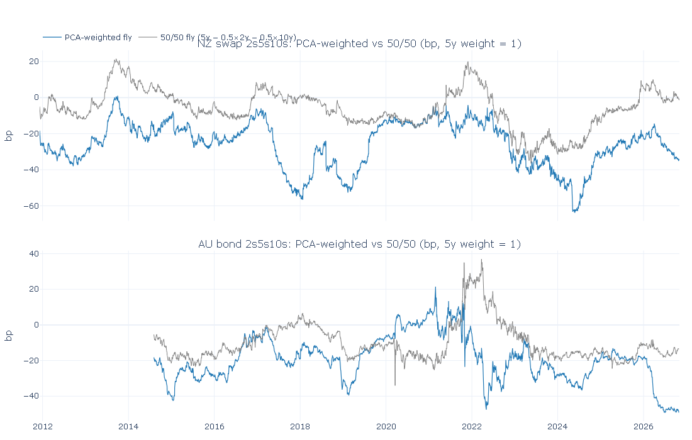
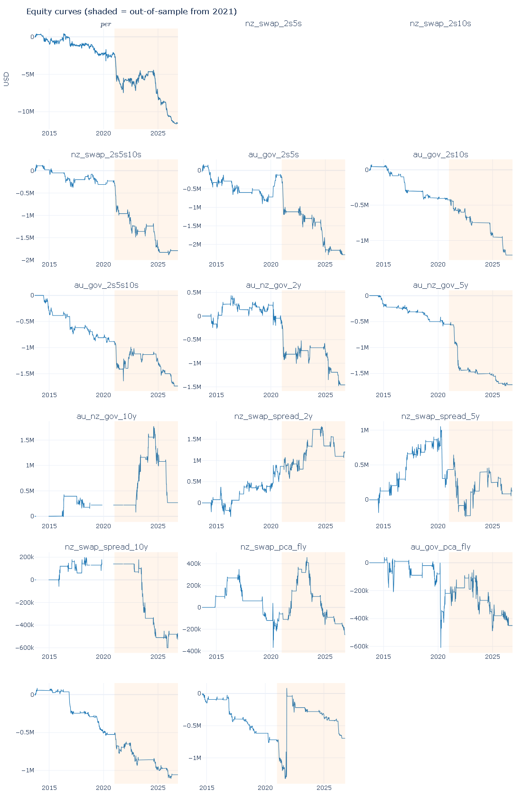
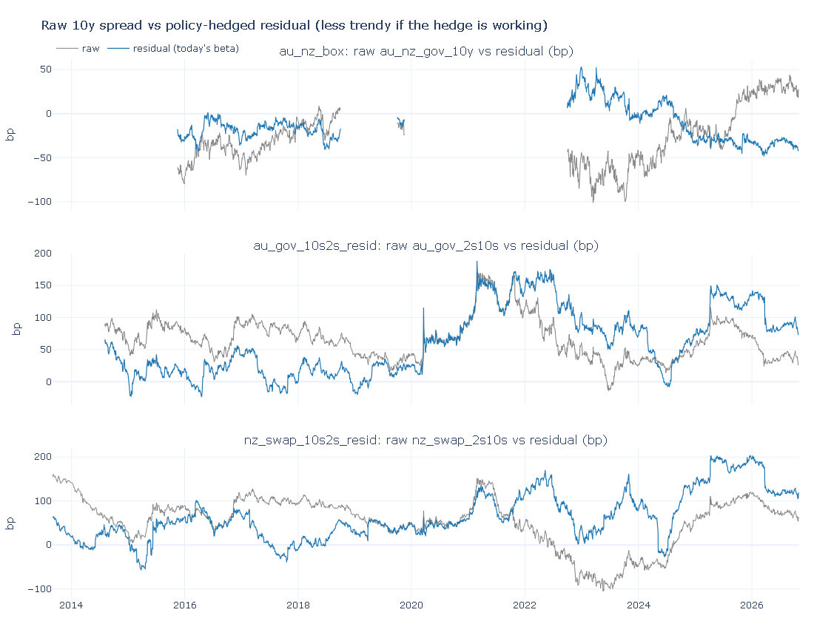
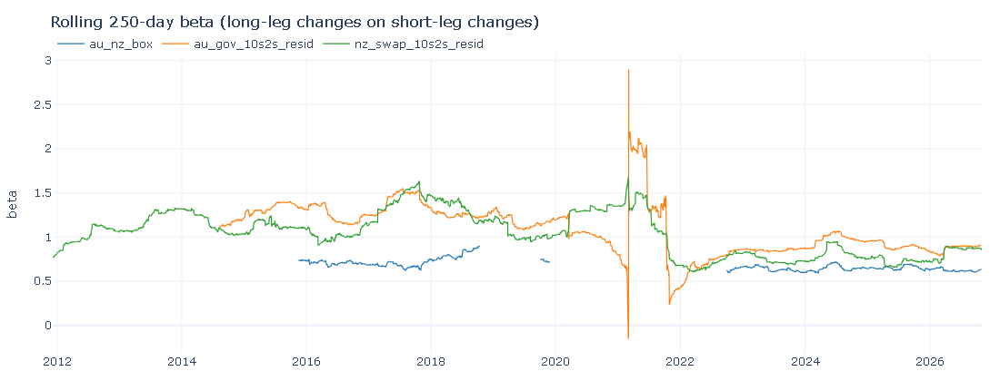
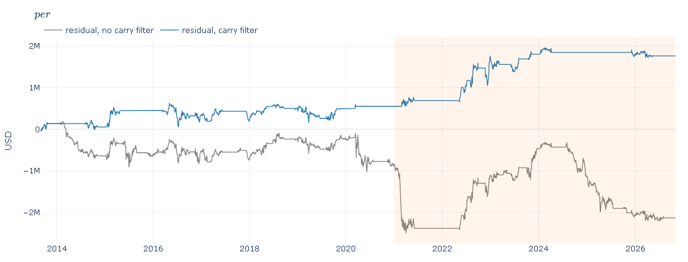

# Rates Relative Value (RV) Scanner — Australia & New Zealand

A research project that mirrors the workflow of a rates relative-value trading desk:
a daily scanner for unusually stretched spreads, a backtester, a paper-trading PnL
book and a public dashboard. *(Work in progress — built step by step; sections marked
"coming" are filled in as each step is completed.)*

**Python version:** the project targets **Python 3.13** (`.python-version`).

---

## What is relative value?

Instead of betting on whether interest rates go up or down (an *outright* view),
an RV trader bets on the **relationship between two or more rates** — for example
"the 10-year yield is unusually high compared with the 2-year and 5-year yields".
Positions are built so that a parallel move of the whole curve makes roughly zero
profit or loss; the trade only makes money if the relationship returns to normal.

PCA butterflies (`src/pca.py`) re-weight the 2s5s10s fly so it is (approximately) neutral to parallel shifts and slope changes of the curve; see Step 3. The backtest (`src/backtest.py`) fades stretched z-scores with next-day execution; see Step 4. Hypothesis 3 (`src/residual.py`) hedges the 2y/policy factor out of the 10y spread and fades the residual; see Step 4c. *(Paper PnL book: coming.)*

---

## Step 0 — Data (`src/fetch.py`, `src/validate.py`, `src/rolls.py`)

### Sources

| Clean name | Source | Series ID | What it is |
|---|---|---|---|
| `au_gov_2y`, `au_gov_3y`, `au_gov_5y`, `au_gov_10y` | RBA table F2 | FCMYGBAG2D / 3D / 5D / 10D | Australian Government nominal bond yields, "interpolated, N years maturity" (see below) |
| `nz_gov_2y`, `nz_gov_5y`, `nz_gov_10y` | RBNZ table B2 | INM.DG102 / DG105 / DG110.NZZCF | NZ government **benchmark** bond closing yields |
| `nz_swap_2y`, `nz_swap_5y`, `nz_swap_10y` | RBNZ table B2 | INM.DS02 / DS05 / DS10.NZZC | NZ swap rates (close) |
| `nz_swap_1y`, `_3y`, `_4y`, `_7y`, `_15y` | RBNZ table B2 | INM.DS01 / DS03 / DS04 / DS07 / DS15.NZZC | Extra NZ swap tenors, used only in the NZ PCA fit |

Australia has government bonds only (no swap data), so AUD instruments are built from bonds.
The full mapping, including the original series names, is saved to `data/processed/series_meta.csv`
and printed on every run.

### How the data is updated

* **RBA F2** is downloaded automatically with ordinary HTTP requests. The RBA publishes
  F2 **weekly** (Fridays, with daily yields up to two business days earlier), so
  Australian data usually lags New Zealand data by a few days.
* **RBNZ B2 is supplied manually** (see below), because RBNZ restricts automated access
  to its website and this project respects that.
* Each run re-reads the full source files and *upserts* into `data/processed/rates.csv`:
  new dates are added and missing values filled; values from the last 30 calendar days may
  be revised; **older history is never changed** (differences are logged as warnings).
* `rates.csv` stores values **in percent, exactly as published**, with gaps left empty.
  Small gaps (up to 2 days, e.g. public holidays in one country) are forward-filled only
  when the data is read, and never beyond a series' last published value.
* Every run validates the data: implausible values (an error — nothing is saved),
  moves larger than 25bp in a day, stale (unchanged) values, missing dates, and out-of-date
  sources. Results go to `data/processed/validation_report.csv`.

### Manual NZ data step

1. Go to the RBNZ [Wholesale interest rates (B2)](https://www.rbnz.govt.nz/statistics/series/exchange-and-interest-rates/wholesale-interest-rates) page.
2. Download **"Wholesale Interest Rates – B2 Daily close (2018-current)"** (`hb2-daily-close.xlsx`).
   The first time only, also download the **1985–2017** file for history.
3. Put the file(s) in `data/manual/` (any name containing `b2`, `.xlsx` or `.csv`), replacing the old current file.
4. Run `python -m src.fetch` (or push to GitHub — a push to `data/manual/` triggers the workflow).

All B2 files in `data/manual/` are read; where they overlap, the file with the latest
"Published Date" wins.

### NZ benchmark bond rolls

RBNZ's "2/5/10 year" government bond yields are specific benchmark bonds that RBNZ
switches to newer bonds about once a year, creating artificial jumps. NZ swap rates are
constant-maturity and don't roll, so they are the primary NZ curve (curves, flies, PCA).

Roll dates were reviewed by hand and are kept in `data/processed/roll_dates.csv`:

| status | include | effect |
|---|---|---|
| confirmed (26) | Y | history before the date is back-adjusted by the jump (`nz_gov_*_adj` in `rates_adjusted.csv`), and the roll-day change is excluded from PCA, backtest and PnL |
| unclear (6) | N | roll-day change excluded as a precaution; history **not** adjusted |
| pending | N | a new automatic candidate: change excluded from paper-book PnL, instruments shown as "pending roll review", no new paper trades until reviewed |
| rejected | N | ignored (a real market move) |

After a run flags a new candidate, review it and run
`python -m src.rolls --confirm YYYY-MM-DD nz_gov_2y` (or `--reject`).


**Caveat on back-adjusted levels.** Between switches a benchmark bond gets shorter and
"rolls down" the curve; each switch to a longer bond resets this, usually upwards. The
back-adjusted series removes the resets but keeps the roll-down, so earlier adjusted
levels drift away from what was traded (by 1.7 percentage points for the 2y by 2011).
Daily changes and rolling z-scores before a roll are not affected; long-history levels
and percentiles are.

### Australian yields: method and the 2013 file join

RBA describes each current F2 series as *"Yields on Australian government bonds,
interpolated, N years maturity"*, which is why no AU roll adjustment is applied. The
F2 notes describe the data only as *"the Reserve Bank of Australia (RBA)'s assessment
of closing bond yields on Australian Government Securities"*, and RBA's changes page
records that *"the calculation methodology for a number of interest rate series in
Tables F2 and F2.1 has also been changed"* (31 March 2023). On 29 December 2023 the 2, 3,
5 and 10 year series were *"replaced ... by series calculated from data representing the
Reserve Bank of Australia (RBA)'s assessment of closing bond yields"*. RBA does not publish
the interpolation method itself. The 1995–2013 history file describes its series only as
*"N years maturity"* (no "interpolated").

The history file ends 17 May 2013. The 10y continues seamlessly on 20 May 2013; the
2y, 3y and 5y resume only on 2 September 2013 after a 75-weekday gap, so a method
change there can't be separated from market moves (`python -m src.diagnostics`,
output in `outputs/diagnostics/rba_2013_join.csv`). Day-to-day AU moves unexplained by
NZ swaps are also about twice as frequent in the history file as in the current file.

The two methodology-change dates inside the current file (31 March 2023 and 29 December
2023) show no break: on each date the AU move not explained by NZ swaps was at most about 6bp,
in line with ordinary days (`python -m src.diagnostics --events 2023-03-31 2023-12-29`,
output in `outputs/diagnostics/rba_method_change_windows.csv`). If RBA recalculated the
whole history on the new method, no break would be visible anyway.

**Decisions for the analysis** (in `config.yaml` → `instruments`):
* AU instruments start on **2 September 2013** (current RBA file only).
* NZ swap spreads and AU–NZ bond spreads use **raw** NZ bond yields, so levels match what
  traded; the change on every confirmed, unclear or pending roll day is excluded.
  Back-adjusted yields in `rates_adjusted.csv` are **diagnostic only** — no instrument uses them.
* Bond-based instruments (NZ swap spreads, AU–NZ bond spreads) open no new trades for
  **20 trading days** after a confirmed or unclear roll in an NZ bond they use
  (`post_roll_block_days`), and none while a roll is pending review.
* New roll candidates (after 2 Nov 2026) are flagged if the bond-vs-swap jump is over 5bp
  while the swap moves under 2bp, **or** the jump is over 8bp whatever the swap did.

---

## Step 1 — Instruments (`src/spreads.py`)

Yields are stored in percent; `spreads.py` is the **only** place they are converted to
basis points (1% = 100bp). Each instrument is `100 × Σ weight × yield`, defined in
`config.yaml → instruments.definitions`:

| Group | Instruments | Built from | Sign convention |
|---|---|---|---|
| NZ swap curve | `nz_swap_2s5s`, `nz_swap_2s10s`, `nz_swap_2s5s10s` | NZ swaps (from Jan 2011) | curve = long tenor − 2y; fly = 2×5y − 2y − 10y |
| AU bond curve | `au_gov_2s5s`, `au_gov_2s10s`, `au_gov_2s5s10s` | AU govt bonds (from 2 Sep 2013) | same |
| AU–NZ bond spread | `au_nz_gov_2y`, `_5y`, `_10y` | AU bond − **raw** NZ bond (from 2 Sep 2013) | positive = AU yields above NZ |
| NZ swap spread | `nz_swap_spread_2y`, `_5y`, `_10y` | NZ swap − **raw** NZ bond | positive = swap above bond |

A positive butterfly means the 5y yield is high relative to the 2y and 10y ("5y cheap").
Back-adjusted NZ bond yields are never used.

* Each instrument stops at the latest date on which **all** its inputs have published data
  (its `as_of` date): NZ-only instruments run to the latest RBNZ date, anything with an AU
  leg to the latest RBA date.
* `data/processed/instruments.csv` has one row per date and instrument: `value_bp`,
  `inputs_filled` (an input was forward-filled over a holiday), `roll_day` (an NZ bond leg
  rolled — that day's change is excluded from backtest and PnL) and `post_roll_block`
  (no new trades: the roll day plus 20 trading days, or until a pending roll is reviewed).
  Roll flags only apply to instruments with an NZ government bond leg.
* `data/processed/instrument_summary.csv` lists each instrument's inputs, formula, start,
  `as_of`, latest value and min / max / mean over its history (all in bp).


---

## Step 2 — Scanner (`src/scanner.py`)

For each instrument the scanner asks: *how unusual is today's level?*

* **z-score** = (today's value − average over the last N trading days) / standard deviation
  over the same window, for N = 60 and 250. The window ends today and never uses later
  data. A z-score of +2 means the instrument is two standard deviations above its recent average.
* Only **real** values count: days where an input was forward-filled over a holiday are left out
  of the statistics and never get a z-score (so they can never trigger a signal).
* **Insufficient history:** the z-score is left empty if fewer than 80% of the window's trading
  days have real values, or if the window contains more than 10 trading days in a row
  without data (e.g. the NZ 2y bond gaps).
* **Percentile** = share of all real values up to and including today that are at or below
  today's value (needs at least 250 values).
* The daily table (`outputs/scanner_<data date>.csv` and `outputs/scanner_latest.csv`) ranks
  instruments by |z_250| (`signal_strength`) and marks a **strong** signal where z_60 and z_250
  have the same sign and are both beyond ±2. Instruments in a post-roll block, with a pending
  roll, insufficient history, a forward-filled latest value or stale data are shown but marked
  **no new trades**. One-day and one-week changes that span an NZ bond roll are left blank.
* `data/processed/scanner_history.csv` keeps the z-scores for every date (input to the backtest).
* Charts per instrument in `outputs/charts/scanner/`: value with the 250-day mean and ±1/±2
  standard-deviation bands, and the 60- and 250-day z-scores.

Note: a z-score measures how far an instrument is from its *recent* average, a percentile
from its *whole* history. They can disagree: AU–NZ 2y is near its widest ever (98.7th
percentile) but only +0.9 sd vs its 250-day average, because it has been wide all year.


---

## Step 3 — PCA butterflies (`src/pca.py`)

A 50/50 fly (`5y − 0.5×2y − 0.5×10y`) is only roughly duration-neutral. It still
makes or loses money when the whole curve shifts in parallel (PC1, “level”) or
pivots (PC2, “slope”), because the three legs do not have equal sensitivity to
those moves. PCA weights are chosen so that, on recent *yield changes*, a 1 unit
5y position hedged with `w2` of 2y and `w10` of 10y has (approximately) zero
exposure to PC1 and PC2. What is left is mostly PC3 — genuine curvature.

**Fit** (each date *t*, no look-ahead): covariance PCA on daily yield changes in bp
over the trailing 250 trading days, using only data dated *t* or earlier. Forward-filled
days and NZ-bond roll days are left out of the fit.

* **NZ:** all B2 swap tenors (1y, 2y, 3y, 4y, 5y, 7y, 10y, 15y). A tenor that is
  missing for too much of the window is dropped, so 15y can join later without
  blocking earlier dates. The fly itself is still 2s5s10s.
* **AU:** government bonds 2y / 3y / 5y / 10y, from 2 September 2013.

Eigenvector signs are fixed so PC1 loadings sum positive (a parallel sell-off)
and PC2 is positive at the long end (a steepener). That stops the stored loadings
flipping sign from one day to the next with no economic reason. The 5y weight is
always 1; `w2` and `w10` solve `w · PC1 = 0` and `w · PC2 = 0` on the fly legs.

**Z-scores:** at date *t* the fly’s last 60/250 days are *rebuilt with that date’s
weights* (not stitched from yesterday’s weights) and then z-scored. A change in
the weights cannot by itself create a signal. The PCA flies `nz_swap_pca_fly` and
`au_gov_pca_fly` are added to the scanner.

**Diagnostics** (in `outputs/`):

* `pca_weights.csv` — daily `w2`, `w5=1`, `w10` and variance explained by PC1–3
* `pca_oos.csv` — walk-forward: yesterday’s weights and loadings applied to today’s
  change. The PCA fly’s daily changes should have near-zero correlation with PC1
  and PC2; the 50/50 fly’s should not.
* Charts: `pca_variance`, `pca_fly_vs_simple`, `pca_oos`

Run `python -m src.pca` before `python -m src.scanner` so the scanner picks up the flies.



---

## Step 4 — Backtest (`src/backtest.py`)

A walk-forward test of fading the scanner: **short** when `z_250 > +2`, **long** when
`z_250 < −2`, exit when `|z_250| < 0.5`, stop if `|z_250| > 3.5`, flatten after 60
trading days. The signal is taken at close *t* and the trade is done at close *t+1*.
One position per instrument. These rules live in `config.yaml → backtest` and are
**not tuned on the out-of-sample window**.

No new trade if the signal day is forward-filled, has insufficient 250-day history,
is in a post-roll block, or has a pending NZ-bond roll. Confirmed / unclear / pending
roll-day changes are excluded from PnL and any open bond-based trade is flattened at
the previous close (we do not hold a benchmark through its switch).

**In-sample** 2 Sep 2013 – 31 Dec 2020; **out-of-sample** 1 Jan 2021 – latest.
Daily PnL, Sharpe and drawdown are split by calendar date; trade counts and hit rate
are split by entry date.

### DV01 and costs (assumptions)

Each instrument is a yield combination with weights `w_i`. Notionals are chosen so
the dollar DV01 of leg *i* equals `k × w_i`, and the **long side sums to $10,000 DV01**.
When the weights sum to zero (every non-PCA instrument; PCA flies nearly so) the book
is net-DV01-neutral: a 1bp parallel shift of every leg is worth about $0, and a 1bp
move in the combination is worth `$k`. Par modified duration at **4%**
(`(1 − 1.04^(-n)) / 0.04`) is used for every tenor *n* read from the series name.
That is a stated assumption, not a live-market quote: no coupon frequency, no
convexity, no AU vs NZ duration difference beyond tenor.

PnL is reported in **bp of the yield combination** and in **$ per $10k long-side DV01**.
One-way costs are 0.5bp per NZ swap leg and 1bp per government-bond leg, charged at
entry and again at exit.

PCA flies are signalled from the scanner z-score (which restates weights each day)
but **marked with the weights frozen at the signal date**, which is the fly that was
actually put on.

### Diagnostics

* `outputs/backtest_trades.csv`, `backtest_daily.csv`, `backtest_metrics.csv`
* `outputs/backtest_sensitivity.csv` — entry 1.5 / 2.0 / 2.5 × exit 0 / 0.5 (a report;
  the default 2.0 / 0.5 is not chosen from this table)
* `outputs/backtest_yearly.csv`, `backtest_worst_trades.csv`
* `outputs/backtest_events.csv` — RBA and RBNZ decision dates (official), AU CPI
  (last Wednesday of the month, with documented exceptions), NZ CPI (16 weekdays
  after quarter-end, an approximation of Stats NZ’s “about 12 working days”)
* Charts in `outputs/charts/backtest/`: equity curves, z-score with trade markers,
  PnL by year

A trade is tagged “open across an event” if an RBA/RBNZ decision or CPI print for
that market falls strictly after entry and on or before exit.



On the committed rules the book **loses money**, more so out of sample than in sample
(OOS hit rate 27%, Sharpe −1.0). NZ and AU curve/fly trades fade a 250-day z-score
through the 2021–23 hiking cycle and the 2024–26 easing cycle, both of which ran as
one-way flatten-then-steepener trends; simple 2s5s10s flies stop out on half or more
of OOS trades. AU–NZ 5y is the least-bad (OOS hit rate 58%) but Sharpe is still only
0.14. Every cell of the sensitivity table is also OOS-negative, so this is not an
artefact of the particular 2.0 / 0.5 thresholds. Step 5 (paper PnL) should not treat
this scanner as a licence to trade size.

---

## Step 4c — Hypothesis 3: policy-hedged residual RV (`src/residual.py`)

Step 4 lost money fading raw 2s10s and AU–NZ 10y z-scores because those spreads
**trend with the policy cycle**: hiking cycles flatten the curve for years,
easing cycles steepen it. A standard desk next try (not a data-mined one) is to
hedge the 2-year / policy factor out of the 10-year spread and fade only what is
left.

The residual on date *t* is

`y_long,t − β_t × y_short,t`

where `β_t` is the slope from a 250-trading-day regression of **daily changes**
of the long leg on the short leg, fitted only on data dated *t* or earlier.
Filled days and NZ-bond roll days are left out of the fit. At date *t* the
residual's last 60 and 250 days are **rebuilt with that day's β** (not stitched
from yesterday's β) and then z-scored — the same idea as the PCA fly.

Three residuals, all in bp:

| Name | Residual |
|---|---|
| `au_nz_box` | (AU10 − NZ10) − β × (AU2 − NZ2) |
| `au_gov_10s2s_resid` | AU10 − β × AU2 |
| `nz_swap_10s2s_resid` | NZ10 swap − β × NZ2 swap |

**Carry + rolldown (stated assumptions, not live-market quotes).** For each leg,
approximate 3-month carry and rolldown in bp from the current curve: roll down
the curve by linearly interpolating yield vs tenor among the available points
(AU 2/3/5/10; NZ swaps 1/2/3/4/5/7/10/15; NZ govt 2/5/10); below the shortest
or above the longest tenor the yield is held at the end-point. Funding is the
shortest available rate on that market (`au_gov_2y`, `nz_swap_1y` falling back
to `nz_swap_2y`, `nz_gov_2y`). Carry in bp of yield over horizon *h* = 0.25y is
`(y − funding) × h × 100 / modified_duration`, with par modified duration at the
**current** yield. No convexity. The residual's carry is the long-leg combo's
carry+roll minus β times the short-leg combo's.

**Rule.** Same as Step 4 (fade `|z_250| > 2`, exit `< 0.5`, stop `> 3.5`, max
hold 60 trading days, signal at *t* / trade at *t+1*, same costs, same
roll/filled/post-roll blocks) **plus** a carry filter fixed in advance: enter
only when the 3-month carry+rolldown of the *trade direction* is ≥ 0. The 10y
combo is sized at $10k DV01; the hedge is `β ×` that DV01 (the box is then
net-DV01-neutral; the curve residuals are not). Marks use β frozen at the
signal date. The same backtest is also run **without** the carry filter so the
filter's effect is visible.

Parameters live in `config.yaml → residual` and were **not tuned** on 2021–.
This hypothesis was chosen from desk practice **after seeing Step 4**, so the
out-of-sample window is **not a pristine hold-out**. Step 4's own metrics and
charts are left untouched; this step only reads `outputs/backtest_metrics.csv`.

### Diagnostics

* `data/processed/residual_history.csv` — residual level, frozen-β z-scores, 3m carry
* `outputs/residual_beta.csv`, `residual_metrics.csv`, `residual_trades.csv`,
  `residual_trades_nocarry.csv`, `residual_halflife.csv`
* Charts in `outputs/charts/residual/`: raw 10y spread vs residual, rolling β,
  equity with vs without the carry filter

Half-lives are AR(1) on **levels**, in-sample only: `ln(2) / −ln(φ)`. A shorter
residual half-life than the raw spread is the hedge doing its job.

### Results

Half-life of mean reversion (AR(1) on levels, **in-sample only**):

| Instrument | Raw spread | Residual |
|---|---|---|
| AU–NZ box vs `au_nz_gov_10y` | 103d | **23d** |
| AU 10s2s residual vs `au_gov_2s10s` | 103d | **73d** |
| NZ swap 10s2s residual vs `nz_swap_2s10s` | 235d | **74d** |

The hedge does shorten the memory of the spread — most clearly on the AU–NZ box,
where the raw 10y spread trended with the 2022–26 policy cycle and the residual
did not. Latest β: box 0.63, AU 10s2s 0.90, NZ 10s2s 0.86. β spiked around the
2020–21 COVID / hiking turn (AU briefly > 2) and then settled near 0.6–0.9.

Backtest, same IS (2013-09 to 2020-12) / OOS (2021-01 to latest) split as Step 4.
PnL is $ per $10k DV01 on the 10y combo.

| Rule | Sample | Trades | Hit % | Avg bp | Sharpe |
|---|---|---|---|---|---|
| Step 4 baseline (all instruments) | IS | 238 | 42 | −2.0 | −0.29 |
| Step 4 baseline (all instruments) | OOS | 227 | 27 | −4.3 | −1.03 |
| Residual **with** carry filter | IS | 22 | 55 | +2.5 | +0.25 |
| Residual **with** carry filter | OOS | 14 | 86 | +8.7 | +0.59 |
| Residual **without** carry filter | IS | 47 | 51 | −2.7 | −0.23 |
| Residual **without** carry filter | OOS | 39 | 44 | −2.2 | −0.36 |

The carry filter is doing most of the work: without it the residual book still
loses, just less than Step 4. With it, trades are scarce (the box had **no**
in-sample entries) and OOS is 14 trades, so the +0.59 Sharpe is a small sample.
AU 10s2s typically has positive 3-month carry on a long residual (~+4bp median),
so the filter mostly allows longs (fade a cheap residual) and blocks shorts.
That is the intended desk rule — do not fade against carry — not a claim that
the residual is a robust money-maker.







---

## How to run

```powershell
py -3.13 -m venv .venv
.\.venv\Scripts\activate
pip install -r requirements.txt

python -m src.fetch      # update data/processed/rates.csv
python -m src.rolls      # flag new roll candidates, back-adjust, chart
python -m src.spreads    # build the RV instruments (bp)
python -m src.pca        # PCA-weighted 2s5s10s flies and diagnostics
python -m src.scanner    # z-scores, percentiles and today's ranked table
python -m src.backtest   # fade z-scores, IS/OOS metrics and charts
python -m src.residual   # Hypothesis 3: policy-hedged residual RV
python -m src.diagnostics   # one-off check of the 2013 RBA file join
pytest                   # run the tests
```

---

## Data sources and attribution

* Reserve Bank of Australia, Statistical Table F2 — Capital Market Yields – Government Bonds – Daily.
* Reserve Bank of New Zealand, Statistical Table B2 — Wholesale interest rates (sources: RBNZ, Reuters, NZFMA).
  RBNZ statistics may be copied, distributed and adapted subject to the conditions on the RBNZ copyright page.

*(Paper PnL book, limitations and deployment instructions: coming.)*
